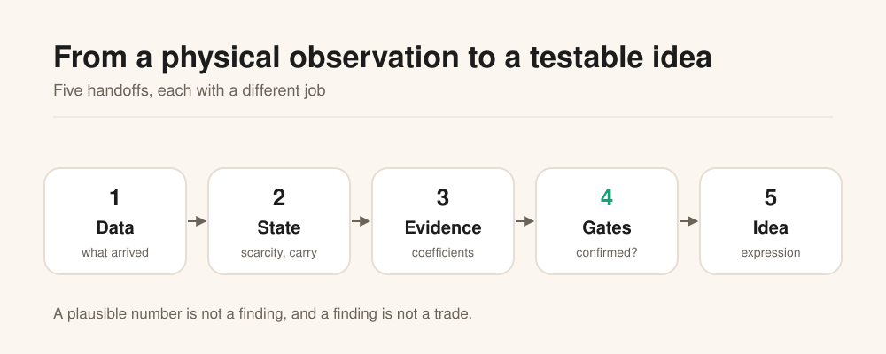

# The Commodity Factor Model

**A visual, reproducible study of how physical scarcity shapes the oil and gas futures curve.**

[](#what-is-not-in-this-repository)
[](#what-is-not-in-this-repository)
[](#method-in-one-page)
[](LICENSE)

---

## The question

Oil and gas are physical markets. When the stock of a commodity is low relative to the same
week in prior years, the nearby barrel should be worth more than the deferred one. The futures
curve should **backwardate**.

Is that true in the data, how strong is it, and can it be used to form a testable trade idea
without confusing a plausible story with an edge?

This repository is the public explanation of a private research program that tests that
question. It contains the method, the aggregate results, the diagrams, the estimator, and the
honest limits. It contains **no market data**.

**Repository:** `Chanta007/commodity-factor-model` · **Default branch:** `dev` ·
**Published:** [chanta007.github.io/commodity-factor-model](https://chanta007.github.io/commodity-factor-model/)

---

## The idea in one picture



Five jobs, in order:

1. **Data.** What arrived, from where, and is it complete.
2. **State.** How scarce is the stock, and what does the curve pay.
3. **Evidence.** Does the relationship survive a controlled test.
4. **Gates.** Is the result confirmed, no edge, or falsified.
5. **Idea.** Only then, an expression and a registered prediction.

A plausible number is not a finding. A finding is not a trade.

---

## What scarcity looks like

Scarcity is the state variable, so it is worth seeing its shape. The left panel is the **actual
aggregate distribution** of the seasonal z-score for WTI and Henry Hub, with no dates and no series.
The right panel is a **synthetic demonstration** of how the z-score is built, because the public
repository does not publish dated market observations.


Two facts stand out. Oil's distribution is **not centred at zero**: its median is -0.46, its 10th
percentile is -4.71, and 44.7% of weeks sit beyond one standard deviation. That left tail is the
2020 storage build. Gas is closer to centred: median -0.07, p10 -1.53, p90 1.04, with 34.9% beyond
one standard deviation. A model that treated "one z-score" as the same event in both markets would
miss that.

---

## What we found

| Result | Oil (WTI) | Gas (Henry Hub) |
|---|---|---|
| Scarcity coefficient on annualised carry | **0.0311** (t 3.49) | **0.1724** (t 6.86) |
| Fit (R²) | 0.140 | **0.739** |
| Walk-forward error vs seasonal naive | **28.3% lower** | **53.2% lower** |
| Walk-forward error vs random walk | worse (0.120 vs 0.042) | worse (0.173 vs 0.100) |
| Direction accuracy | 48.7% | 53.7% |

The common-factor test finds a **liquids factor**, not one global energy market: the median
first-component share is **0.561** against a null of **0.243**, rising to **0.667** when gas is
excluded. Gas is a second factor.

**Score: 12 confirmed, 2 no-edge, 1 falsified.**


---

## How it works

### 1. Measure scarcity, not the weekly change

Scarcity is this week's inventory against the same ISO week in the prior five years, in standard
deviations. A high value means the stock is tight. The weekly build is noisy and largely already
in the stock; it adds little once the level is known.

### 2. Measure the shape of the curve

Carry is the annualised three-month slope:

```text
carry = 4 × ln(nearby / fourth contract)
```

Positive means backwardation; negative means contango.


### 3. Control for the obvious alternatives

The regression includes the policy buffer, the short rate, industrial production, the dollar,
realised volatility and month dummies. The standard errors allow for overlapping, autocorrelated
data (HAC).


### 4. Test the factor, the state and the out-of-sample

The factor test compares the observed common share with the share the same estimator returns on
independent series. The state test splits the sample at 2020 and adds a tight-storage dummy. The
out-of-sample test re-estimates on the past and scores the next period.


---

## What is built, what is in progress, what is researched

| Status | Item |
|---|---|
| **Built** | Data layer for EIA stocks and production, FRED controls, and vendor curves; scarcity and carry construction; controlled regressions with HAC; common-factor null; state splits; walk-forward; registered scorecard; deterministic figures |
| **Built** | A private research repository with a committed manifest, a data catalog, revision tracking, and a held-out vault |
| **In progress** | Live curve integration through Databento and ICE; the measured baseline still ends 2024-04-05 |
| **In progress** | A gas event-study layer: polar vortexes, hurricanes, LNG outages and pipeline closures as dated events, not weekly columns |
| **Researched** | A storage-capacity ceiling for gas; the current model uses a linear scarcity term |
| **Researched** | A power leg; no free forward curve was found, so it remains out of scope |
| **Researched** | An automated news and event feed; the current event list is curated and dated by hand |

The full status, with the next test for each item, is in [`docs/roadmap.md`](docs/roadmap.md).

---

## Research, build, publish

| Stage | What it means | Where |
|---|---|---|
| **Research** | The questions, the four claims, the evidence and the limits | [The research](docs/research.md) and [the explainer](docs/explainer.md) |
| **Build** | A readable estimator, deterministic figures, a public-safety check and tests | [`scripts/estimate.py`](scripts/estimate.py), [`scripts/make_figures.py`](scripts/make_figures.py), [`tests/`](tests/) |
| **Publish** | The static site on GitHub Pages, with a CI gate on every push to `dev` | [The site](https://chanta007.github.io/commodity-factor-model/) and [`pages.yml`](.github/workflows/pages.yml) |

## Test it in two minutes

```bash
git clone https://github.com/Chanta007/commodity-factor-model.git
cd commodity-factor-model
make build
```

`make build` regenerates the figures, checks the public/private boundary, runs the tests, and
estimates a known coefficient from synthetic data. Expected demo output:

```text
synthetic demonstration, no market data
true beta      0.1700
estimated beta 0.1684
HAC t          41.09
observations   520
R2             0.769
```

The estimator is not told the coefficient; it recovers it from a synthetic panel. The demo is not
the market result. It shows that the design matrix, the regression and the HAC standard errors work.

## Read the full explainer

| Document | What it covers |
|---|---|
| [**The visual explainer**](docs/explainer.md) | The theory, the evidence and the limits, chart by chart |
| [**The research**](docs/research.md) | The four claims, the scorecard, and what would change the conclusion |
| [**Method in one page**](docs/methodology.md) | The equations, the sample, the tests and how to reproduce them |
| [**Reproducing**](docs/reproducing.md) | Clone, build, demo, expected output, and the published URLs |
| [**Roadmap**](docs/roadmap.md) | What is built, in progress and researched, with the next test |
| [**Data and licences**](docs/data-and-licences.md) | What is not published here, and why |
| [**Figures**](docs/figures/) | The eight SVGs, generated deterministically from the aggregate numbers |
| [**Website**](https://chanta007.github.io/commodity-factor-model/) | The same story as a single scrollable page |

---

## Method in one page

The model is a small, explicit chain:

```text
scarcity_t   = seasonal z-score of inventory
carry_t      = 4 × ln(M1_t / M4_t)
carry_t      = a + b × scarcity_t + controls_t + error_t
```

The coefficient `b` is the object of interest. It is estimated with HAC standard errors, tested
against a null, split by state, and scored out of sample. The scorecard records each rule before
it is run.

Three results define the model:

- The relation is **positive** in both markets, and much stronger in gas.
- The **level** of scarcity matters, the weekly **flow** does not.
- The model explains the **level** of carry and **loses to a random walk** on short-horizon
  changes. It is a map, not a timer.

---

## What is not in this repository

**No market data.** The repository contains no price series, no inventory series, no vendor
files and no point-in-time store. The figures are aggregate summaries generated from the
estimated coefficients and test statistics.

The underlying research uses:

- **EIA** public data for stocks, production and the STEO.
- **FRED** controls under the operator's approval.
- **Databento and ICE** for the live curve, under their licences.

None of those bytes are redistributed here. See [`docs/data-and-licences.md`](docs/data-and-licences.md).

---

## Reproduce the figures

The figures are generated from the aggregate numbers in `scripts/make_figures.py`. They are
byte-identical on every run.

```bash
python3 scripts/make_figures.py
python3 tests/check_public.py
```

The check verifies that no data files are present, that every figure exists, and that the
README's links resolve.

---

## Cite this

```text
Chanta007 (2026). The Commodity Factor Model: scarcity, carry and the shape of the
oil and gas curve. https://github.com/Chanta007/commodity-factor-model
```

A `CITATION.cff` file is included.

---

## Licence

The **text and figures** are licensed under
[Creative Commons Attribution 4.0](https://creativecommons.org/licenses/by/4.0/).
The **scripts** are licensed under the MIT Licence. See [`LICENSE`](LICENSE).

---

*This is research, not investment advice. The results are historical, the model has no live
track record, and the current scarcity reading is a state rather than a forecast.*