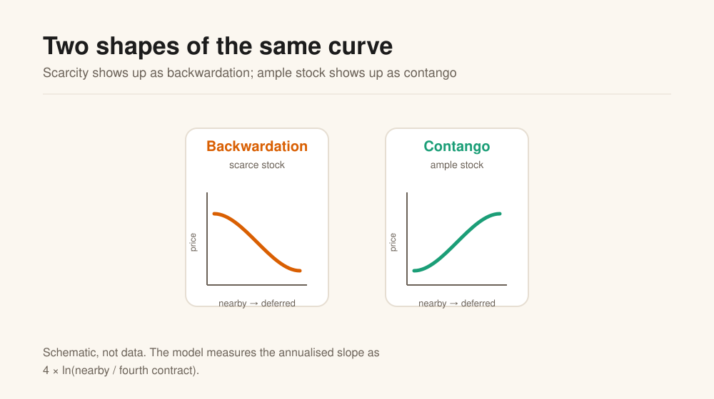
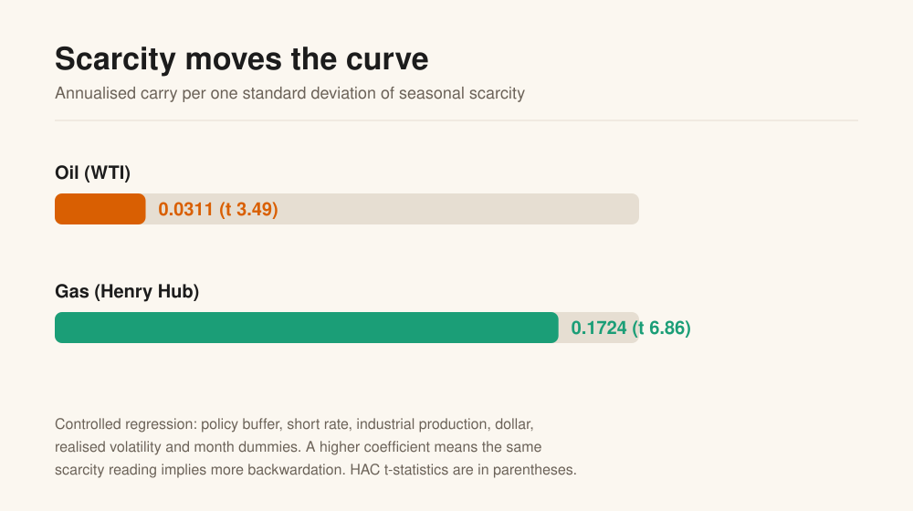
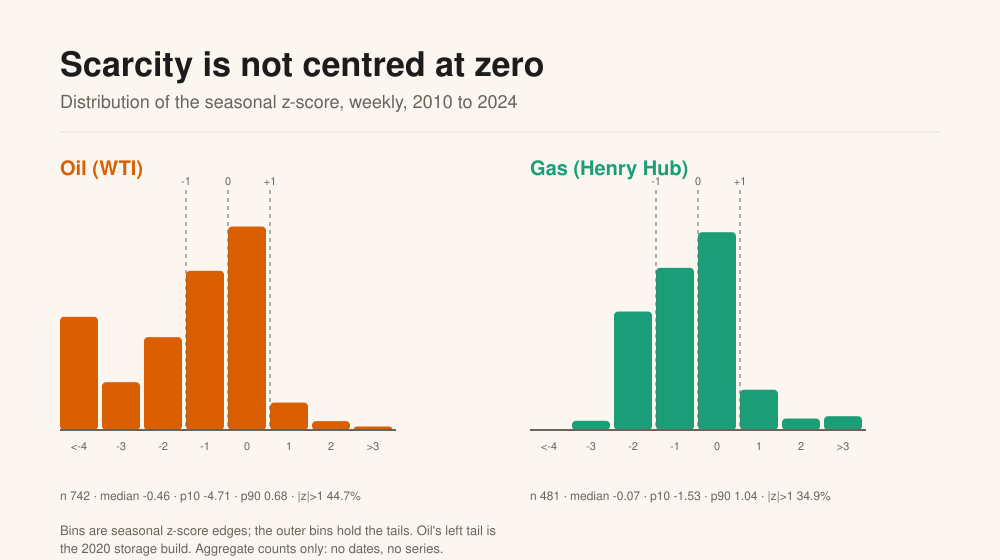
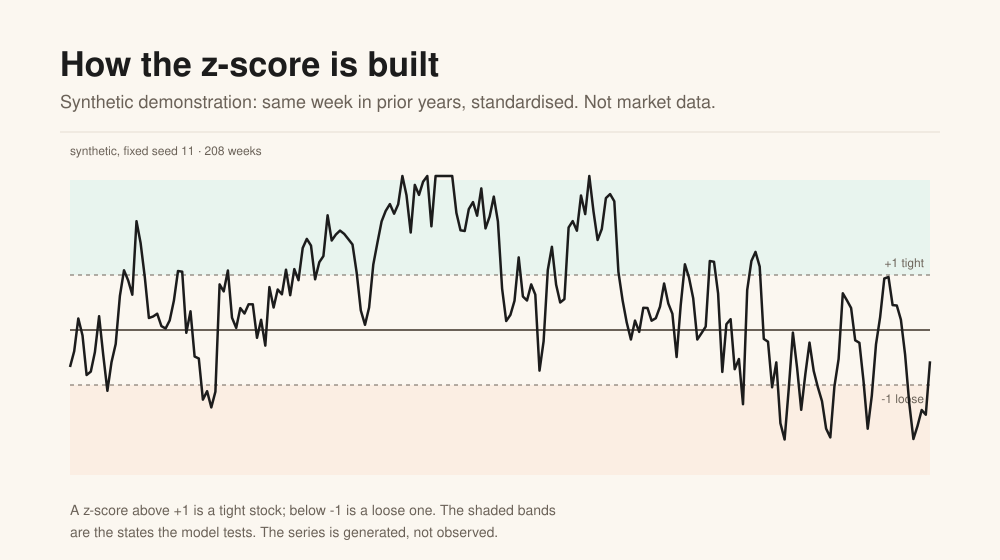
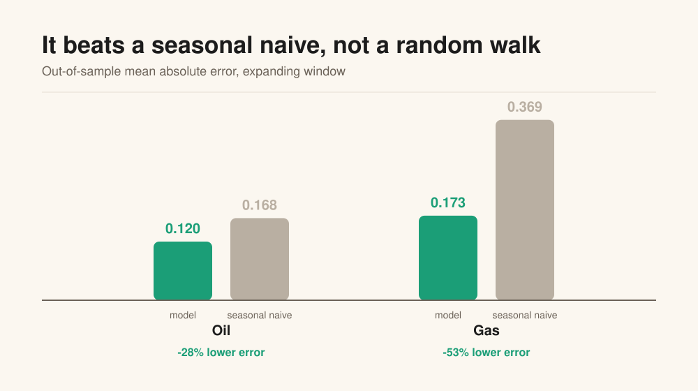
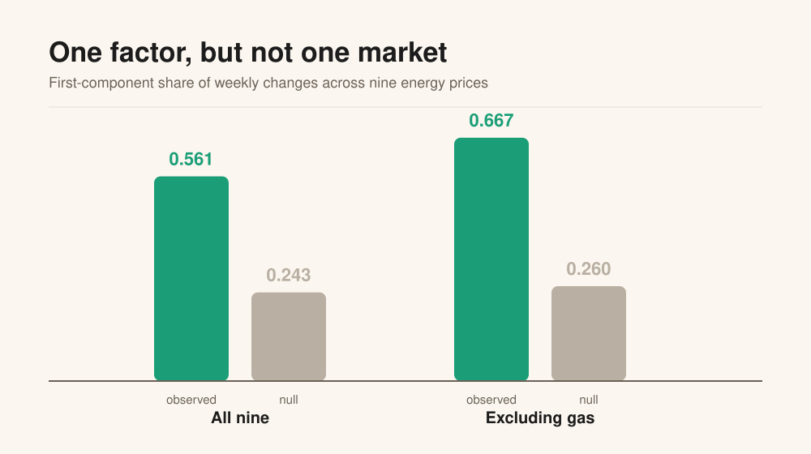
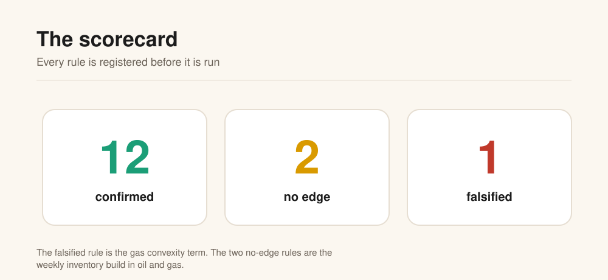

# The visual explainer

**The Commodity Factor Model in eight charts.** Each section has one idea, one picture, and a
short explanation. Read it in about ten minutes.

---

## 1. The question

Oil and gas are physical markets. When the stock is low relative to the same week in prior years,
the nearby barrel should be worth more than the deferred one. That is the theory of storage, and
it predicts a **backwardated** curve.

The model asks three questions:

1. Is the relation in the data, once the obvious alternatives are controlled for?
2. How strong is it, and where is it strongest?
3. Can it frame a trade idea without confusing a story with an edge?

It is not a price forecast.

---

## 2. What the curve is saying



A futures curve has a shape:

- **Backwardation:** nearby above deferred. The market pays for immediate supply.
- **Contango:** deferred above nearby. The market pays for storage.

The model measures the shape as the annualised three-month slope:

```text
carry = 4 × ln(nearby / fourth contract)
```

Positive is backwardation, negative is contango. The question is whether that number moves with
physical scarcity.

---

## 3. Scarcity moves the curve



Scarcity is a **seasonal z-score**: this week's inventory against the same ISO week in the prior
five years, in standard deviations. The coefficient is the change in annualised carry for a
one-standard-deviation increase in scarcity, holding the controls fixed.

- **Oil (WTI):** 0.0311, HAC t 3.49.
- **Gas (Henry Hub):** 0.1724, HAC t 6.86.

A one-standard-deviation scarcity move implies about **3.1 annualised log points** of carry in oil
and **17.2** in gas. The sign is what the storage theory predicts.

The controls are the policy buffer, the short rate, industrial production, the dollar, realised
volatility and month dummies. The standard errors allow for overlapping, autocorrelated weekly
data.

---

## 3b. What scarcity looks like

Scarcity is the state variable. Its distribution is not the same in the two markets.



Oil's median is **-0.46**, its 10th percentile is **-4.71**, and **44.7%** of weeks sit beyond one
standard deviation. The left tail is the 2020 storage build. Gas is closer to centred: median
**-0.07**, p10 **-1.53**, p90 **1.04**, with **34.9%** beyond one standard deviation.

The time-series panel is a **synthetic demonstration**, not market data. It shows the construction:
a z-score above +1 is a tight stock, below -1 a loose one, and those are the states the model tests.



---

## 4. Gas is the stronger market



The gas relation is tighter: R² is **0.739** against **0.140** for oil. In an expanding-window
out-of-sample test, the model's mean absolute error is **28.3% lower** than a seasonal naive for
oil and **53.2% lower** for gas.

It does **not** beat a random walk:

| Market | Model MAE | Random-walk MAE |
|---|---|---|
| Oil | 0.120 | 0.042 |
| Gas | 0.173 | 0.100 |

Direction accuracy is 48.7% for oil and 53.7% for gas. The model explains the level of carry; it
does not time week-to-week changes.

---

## 5. The state matters, in two different ways

Tight storage is a **level shift**: it raises backwardation on its own, by 0.149 in oil (t 5.28)
and 0.299 in gas (t 6.15). The post-2020 change is a **slope change**: the scarcity coefficient
goes from 0.023 to 0.125 in oil and from 0.167 to 0.413 in gas.

The gas difference is the robust one. The oil post-2020 estimate is imprecise (t 1.63). The model
does not use a hand-coded war dummy; it tests a dated split and a storage state.

---

## 6. The weekly build adds little

The obvious alternative is the weekly inventory change. If the build is the news, it should move
the curve after the level is known. It does not.

| Standardised coefficient | Oil | Gas |
|---|---|---|
| Scarcity (level) | 0.221 | 0.447 |
| Weekly build (flow) | 0.081 | 0.025 |

The build has the right sign and no edge: -0.052 (t -1.04) in oil and -0.100 (t -0.96) in gas.
The level matters; the flow is context.

---

## 7. One factor, but not one market



The model takes the first principal component of weekly log changes across nine energy prices
and compares its share with the share the same estimator returns on independent series of the
same shape.

- Median observed share: **0.561**.
- Null: **0.243**.
- Excluding Henry Hub: **0.667** observed against **0.260** null.

The common factor is a **liquids** factor. Gas is a second factor: its last-window loading is
**-0.105**. Treating oil and gas as one market produces false relative-value trades.

---

## 8. The scorecard



Every rule is written down before it is run. The current score:

- **12 confirmed.**
- **2 no edge:** the weekly build in oil and gas.
- **1 falsified:** the gas convexity term.

The energy block has no registered holdout. Its out-of-sample test is the walk-forward on the
stored sample. The rates block has a holdout; this block does not, and the page does not pretend
otherwise.

---

## 9. What it is good at, and what it is not

| Good at | Not good at |
|---|---|
| Explaining the **level** of carry relative to seasonality | Timing week-to-week changes |
| Ranking oil against gas: gas is the stronger relation | Forecasting the price |
| Telling a liquids move from a gas move | Treating energy as one market |
| Showing when the state changes the slope | Measuring a live carry: the stored curve ends 2024-04-05 |
| Making the data limits visible | Filling a missing curve with a proxy and calling it live |

The honest sentence: **the model beats a seasonal naive and loses to a random walk.** It is a map
of where the curve is inconsistent with the stock, not a timing model.

---

## 10. How to use it

The daily loop is a comparison, not a signal service:

1. Refresh the data and note any revision.
2. Compute scarcity from the prior published stock.
3. Compute carry from the stored curve, or from a live curve with an explicit end date.
4. Compare observed carry with the carry the stock implies.
5. Check the state: tight or loose, post-2020 or not.
6. Check the factor: liquids or gas.
7. Name a dated catalyst.
8. Write the expression, the invalidation and the review date.
9. Register the prediction.

If any step is missing, the answer is **no idea**, which is a valid output.

---

## Glossary

| Term | Plain meaning |
|---|---|
| **Carry** | The annualised slope of the curve, `4 ln(nearby / fourth)` |
| **Backwardation** | Nearby above deferred; the market pays for immediate supply |
| **Contango** | Deferred above nearby; the market pays for storage |
| **Scarcity z-score** | This week's stock against the same week in the prior five years |
| **Convenience yield** | The benefit of holding the physical barrel rather than the future |
| **Common factor** | The share of co-movement explained by one component across markets |
| **HAC t** | A significance measure that allows for overlapping, autocorrelated data |
| **Walk-forward** | Re-estimate on the past, test the next period, repeat |
| **Gate** | The test that a claim is identified, scored and not a coincidence |

---

[Back to the landing page](../README.md) · [Method](methodology.md) · [Roadmap](roadmap.md) ·
[Data and licences](data-and-licences.md)